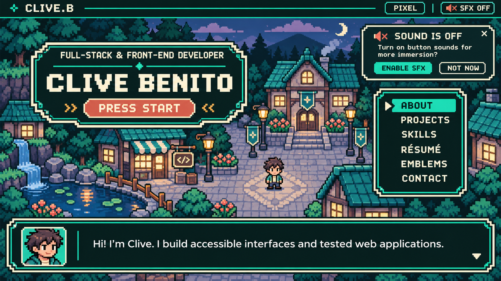

# Pixel Theme Style Guide — R1 Draft

Status: design draft for review. This document and the accompanying mock screen do not change the website.

## Direction

The portfolio keeps its real, recruiter-readable HTML and adopts an original handheld-era pixel RPG presentation. The visual language uses crisp tiles, stepped frames, menu cursors, dialogue boxes, and a limited day/night palette without copying any commercial game artwork, terminology, layouts, or audio.

The selected scope is Option A: a pixel theme of the existing page. The town scene is atmosphere and navigation imagery, not an explorable game world.

## Core principles

- Evidence remains more important than decoration.
- Long-form text stays in a readable sans-serif font.
- Pixel art supports navigation and identity but never hides normal links or controls.
- Motion is skippable, reduced-motion aware, and never flashes.
- Sound is optional, off by default, and never autoplays.
- Pixel and Classic coexist during development. Pixel becomes permanent after it passes the full validation gate; Classic remains only if testing reveals a reason to keep it.

## Pixel grid and geometry

- Base art grid: 16 × 16 pixels.
- Preferred display scales: 3× and 4× integer scaling.
- Art rendering: hard edges with no smoothing or fractional scaling.
- UI frames: original 9-slice construction with stepped 8-pixel corners, a dark outer keyline, a cream inner keyline, and a teal highlight.
- Standard control heights: multiples of 16 pixels, with at least a 44 CSS-pixel interactive target.
- Cursors: a simple original triangular pointer; selected state must also be communicated through text/background contrast, not shape alone.

## Day/night palette

The two palettes share semantic roles so components do not need separate structures. Contrast figures below are draft WCAG ratios for the named foreground/background pair.

### Night

| Role | Hex | Intended use | Contrast |
|---|---:|---|---:|
| Background | `#0B1615` | Page and night-sky base | — |
| Raised surface | `#11211F` | Menus and cards | — |
| Primary text | `#FFF4D6` | Headings and body text | 16.81:1 on background |
| Muted text | `#9DB3AF` | Secondary labels | 8.34:1 on background |
| Brand teal | `#2EC4B0` | Focus, selection, links | 8.46:1 on background; 7.64:1 on surface |
| On-teal ink | `#04201D` | Text on teal controls | 7.84:1 |
| Amber | `#F4B860` | Warm window light and progress | Decorative/status accent |
| Coral | `#E86A5A` | Press Start and attention | Use with dark text after validation |
| Sky blue | `#7DB7D8` | Water, sky, and secondary accents | Decorative |

### Day

| Role | Hex | Intended use | Contrast |
|---|---:|---|---:|
| Background | `#F2E6C8` | Warm outdoor/page base | — |
| Raised surface | `#FFF4D6` | Dialogue boxes and cards | — |
| Frame green | `#244A45` | Borders and navigation framing | 8.95:1 with cream text |
| Primary text | `#132B28` | Headings and body text | 12.06:1 on background; 13.65:1 on surface |
| Muted text | `#4D6762` | Secondary labels | 4.93:1 on background |
| Accessible teal | `#0F675F` | Links, focus, and selection | 5.42:1 on background; 6.13:1 on surface |
| On-teal text | `#FFFFFF` | Text on teal controls | 6.72:1 |
| Amber | `#C87916` | Progress and warm accents | Validate per component |
| Coral | `#B9483C` | Attention and error accents | Validate per component |

## Typography

- Headings, labels, menu items, and short stats: Pixelify Sans, self-hosted.
- Paragraphs, evidence, project details, and form/help text: Plus Jakarta Sans, retained from the current site.
- Minimum body size: 16 CSS pixels with approximately 1.6 line height.
- Pixel headings use normal capitalization and generous line spacing; avoid long all-caps paragraphs.

## Interaction language

- Title entry: “Press Start” may be activated by click, tap, or Enter. It must not block normal page access.
- Navigation: framed menu with a triangular cursor plus a high-contrast selected row.
- Dialogue: full text remains present for assistive technology; visual typing can be skipped and becomes instant under reduced motion.
- Vocabulary remains: Adventurer card, Inventory, Emblem case, Save file, and World map.
- Project buildings are visual landmarks, while every project remains available through ordinary cards and links.

## Sound treatment

- Sound effects are original and generated for the site, not sampled from a game.
- Sound is off by default and never autoplays.
- The first Pixel-theme visit may show one dismissible prompt: “Turn on button sounds for more immersion?”
- Actions may have distinct short sounds for cursor movement, confirm, back/close, opening a dialogue, and successful download.
- Dismissing the prompt is remembered. A persistent header control exposes the current state and lets the visitor change it later.

## Art ownership plan

- Town tiles: select a CC0 pack during R2 and record every source/file in `docs/credits.md`.
- UI frames, cursors, indicators, icons, and emblems: original custom work.
- Avatar: drawn by Clive in Aseprite; the R1 mock uses a placeholder character only.
- Buildings: original custom designs or clearly transformed compositions built from credited CC0 tiles; never traced from an existing game.

## R1 mock screen

The mock demonstrates the night palette, title treatment, atmospheric town, start-menu navigation, dialogue frame, and sound suggestion. It is a direction-setting image, not a production screenshot. The avatar, buildings, scenery, icons, exact spacing, and generated lettering are placeholders to be redrawn or implemented accessibly in R2–R4.

## Review gate

Before R2 begins, confirm or revise:

1. Overall mood and density.
2. Frame shape and cream/teal border treatment.
3. Night palette and the idea of a corresponding warm day palette.
4. Menu placement and dialogue-box proportions.
5. Placement and tone of the one-time sound prompt.

