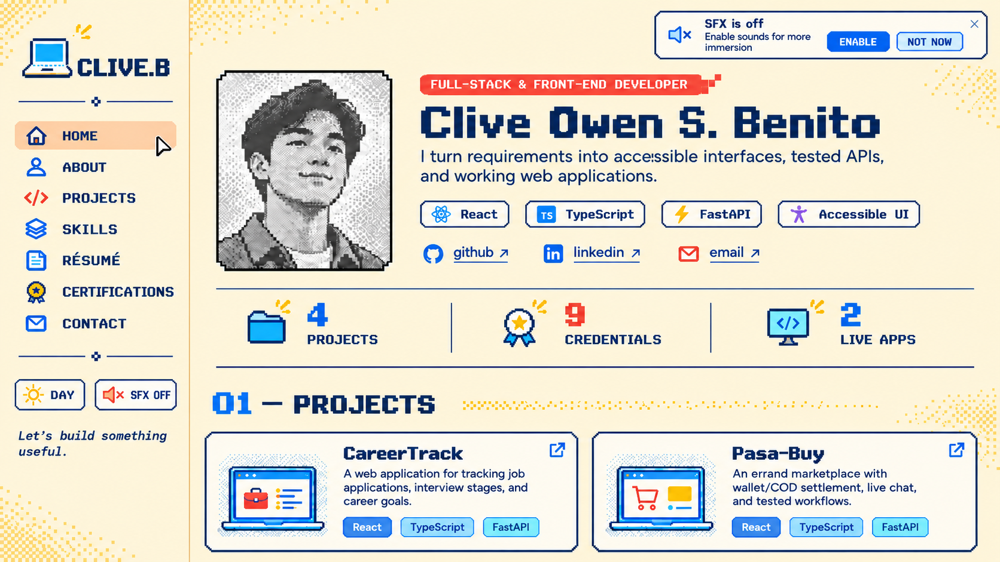

# Pixel Theme Style Guide — R1 Draft v3

Status: revised design draft for review. This document and the accompanying mock screen do not change the website.

## Corrected direction

The portfolio remains a normal, recruiter-friendly scrolling website. Its structure takes broad inspiration from the qualities Clive identified in Bryl Lim's portfolio: a compact fixed sidebar, spacious editorial composition, prominent portrait and introduction, numbered content sections, concise statistics, and restrained interactive details.

The site is not presented as a game screen or an explorable world. The 8-bit character comes from typography, crisp icons, stepped borders, squared chips, halftone/pixel image treatment, cursor details, and small sound effects. The result must remain original and must not copy Bryl Lim's layout, content, graphics, or code.

The selected scope remains Option A: a pixel theme applied to the existing real HTML and content model.

## Core principles

- Evidence and easy scanning remain more important than decoration.
- Use a familiar portfolio layout: sidebar navigation, editorial hero, statistics, then normal content sections.
- Long-form text stays in a readable sans-serif font.
- Pixel styling supports hierarchy and identity but never hides normal links or controls.
- Avoid a full-screen title sequence, town map, walking avatar, game HUD, or large dialogue box as the primary interface.
- Motion is skippable, reduced-motion aware, and never flashes.
- Sound is optional, off by default, and never autoplays.
- Pixel and Classic coexist during development. Pixel becomes permanent after it passes the full validation gate; Classic remains only if testing reveals a reason to keep it.

## Layout system

- Desktop: fixed left sidebar approximately 14–16rem wide; main content uses a centered editorial column.
- Hero: two columns, with a halftone/pixel-treated portrait and a readable introduction.
- Sections: numbered headings, thin rules, and generous whitespace instead of game-scene panels.
- Mobile: sidebar becomes the existing accessible menu; content returns to one column.
- Project cards remain ordinary links/cards with screenshots and evidence, styled through crisp borders and pixel details.

## Pixel grid and geometry

- Base icon/art grid: 16 × 16 pixels.
- Preferred art scaling: 3× and 4× integer scaling.
- Art rendering: hard edges with no smoothing or fractional scaling.
- Borders: mostly 1–2 CSS-pixel keylines with occasional stepped corners; heavy 9-slice frames are reserved for small feature moments.
- Standard controls must keep at least a 44 CSS-pixel interactive target.
- A small triangular cursor may reinforce the active navigation row, but background and text contrast must communicate the same state.
- Dither and halftone textures are accents, never placed behind long body text.

## Day and night themes

“Day” is the light color theme. “Night” is the dark color theme. They use the same layout, content, components, and illustrations; switching themes changes color tokens only. It does not change the scene, time, navigation, or available content.

### Day — light mode

| Role | Hex | Intended use | Contrast |
|---|---:|---|---:|
| Background | `#FFF6D8` | Warm sunny page base | — |
| Raised surface | `#FFFDF3` | Cards and sidebar | — |
| Selected surface | `#FFD3B6` | Active navigation and soft emphasis | — |
| Primary text | `#17324D` | Headings, outlines, and body text | 12.14:1 on background |
| Muted text | `#4D5F70` | Secondary labels | 6.10:1 on background |
| Accessible cobalt | `#245AA5` | Links, focus, and primary controls | 6.31:1 on background; 6.82:1 with white text |
| Sky blue | `#4EA5E8` | Icons and decorative highlights | Validate per component |
| Cyan | `#25B7D3` | Secondary highlights | Decorative or use with dark text |
| Accessible vermilion | `#B73D33` | Strong accents and alerts | 5.21:1 on background |
| Sunny yellow | `#F3C847` | Sparks, badges, and emphasis | 8.23:1 with navy text |
| Accessible violet | `#6248A8` | Occasional secondary accents | 6.45:1 on background |

### Night — dark mode

| Role | Hex | Intended use | Contrast |
|---|---:|---|---:|
| Background | `#101A33` | Deep navy page base | — |
| Raised surface | `#182746` | Cards and sidebar | — |
| Primary text | `#FFF6D8` | Headings and body text | 15.95:1 on background |
| Muted text | `#B4C6E2` | Secondary labels | 9.95:1 on background |
| Bright blue | `#72A7FF` | Focus, selection, and links | 7.13:1 on background |
| Cyan | `#51D2F0` | Secondary highlights | 9.71:1 on background |
| Coral | `#FF7965` | Strong accents and alerts | 6.71:1 on background |
| Sunny yellow | `#FFD45A` | Sparks, badges, and emphasis | 12.17:1 on background |
| Violet | `#B69AF5` | Occasional secondary accents | 7.33:1 on background |

## Typography

- Headings, labels, menu items, section numbers, and short statistics: Pixelify Sans, self-hosted.
- Paragraphs, evidence, project details, and help text: Plus Jakarta Sans, retained from the current site.
- Minimum body size: 16 CSS pixels with approximately 1.6 line height.
- Avoid long all-caps paragraphs and oversized pixel-display text.

## Interaction language

- Navigation is a normal sidebar/header menu with a high-contrast active row and optional small pixel cursor.
- There is no blocking “Press Start” entry screen. If the phrase appears at all, it is a small decorative call to action, not a gate.
- Project cards, tabs, dialogs, downloads, and external links keep their existing accessible behavior.
- Vocabulary remains: Adventurer card, Inventory, Emblem case, Save file, and World map. These are section labels or small motifs, not reasons to hide the underlying content.
- Any typewriter text is optional, immediately skippable, and instant under reduced motion.

## Sound treatment

- Sound effects are original and generated for the site, not sampled from a game.
- Sound is off by default and never autoplays.
- The first Pixel-theme visit may show one compact dismissible notice: “Enable sounds for more immersion.” It must not cover navigation or primary content.
- Actions may have distinct short sounds for navigation, confirm, back/close, dialog open, and successful download.
- Dismissal is remembered. A persistent sidebar/header control always exposes the current state.

## Art ownership plan

- Portrait: use Clive's real formal photo with a non-destructive monochrome halftone/pixel treatment; the R1 mock portrait is a placeholder and not Clive's likeness.
- UI icons, cursors, indicators, and emblems: original custom work.
- Small decorative illustrations: original work or CC0 assets recorded file-by-file in `docs/credits.md`.
- The earlier plan for town tiles and project buildings is removed from the core direction because this is a styled portfolio page, not an overworld.
- Clive may still create an optional small avatar in Aseprite as a personal signature, but it is not required for navigation.

## R1 mock screen — revised

This mock demonstrates the corrected direction: Day as light mode, a fixed sidebar, a spacious two-column hero, restrained pixel treatment, compact stats, normal project cards, and a small sound notice. The palette deliberately contains no green; cobalt blue is primary, vermilion is the strongest accent, and yellow, cyan, and violet provide supporting energy. It is a direction-setting image rather than a production screenshot. The portrait, icons, exact spacing, and generated lettering are placeholders to be implemented accessibly in R2–R4.

The earlier town/title-screen mock is superseded and is retained only as design history.

## Review gate

Before R2 begins, confirm or revise:

1. The fixed-sidebar and editorial-page direction.
2. The amount of pixel styling versus whitespace.
3. Day/light palette and the rule that Night uses the identical layout with dark tokens.
4. Portrait treatment and placement.
5. Project-card density and the compact sound notice.

